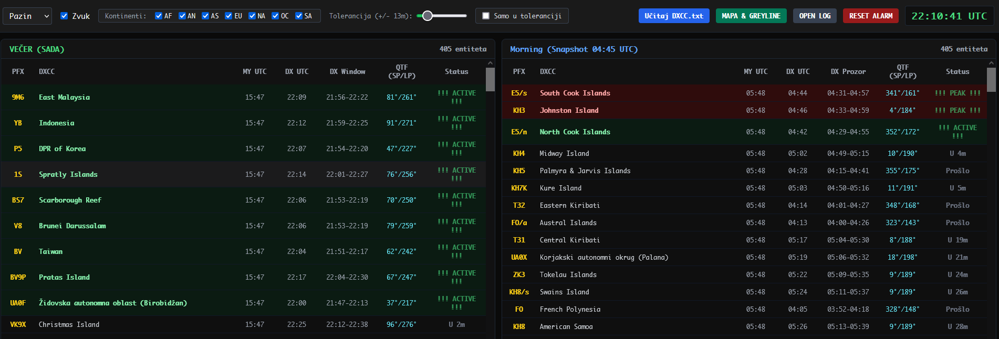
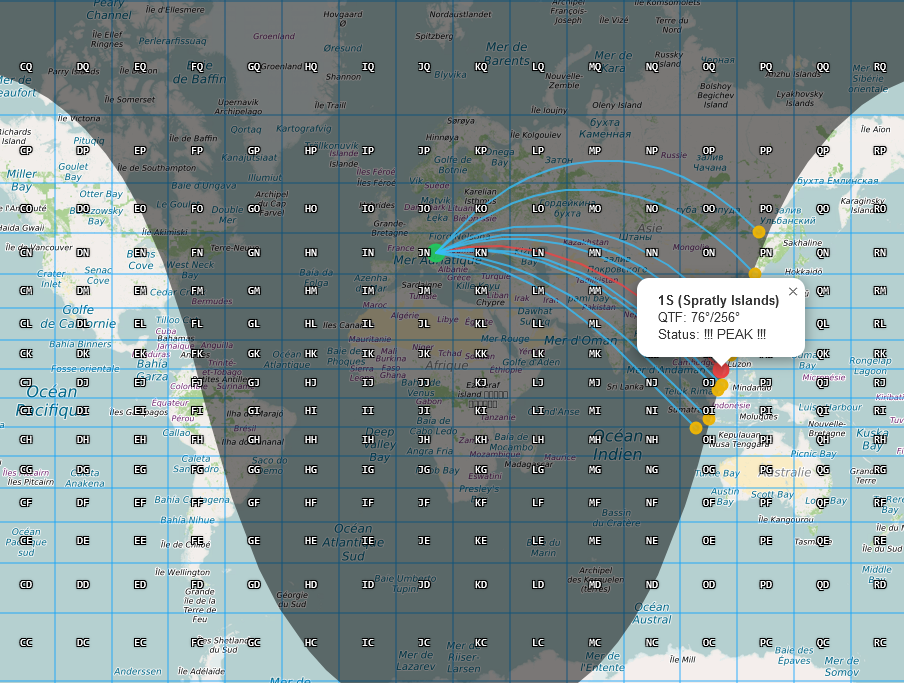

# sunset-sunrise-dx-planner
sunset sunrise dx planner optimised for the low bands

<p align="center">
  
</p>

<p align="center">
  
</p
  
# 9A5CW Hybrid DX Radar & Propagation Planner (V.4.3 Master Edition)


**9A5CW Hybrid Radar** is a lightweight, single-file HTML5/JS web application designed for radio amateurs (HAMs) to track, plan, and analyze DX propagation opportunities in real time. 

By combining exact solar time calculations (sunrise/sunset/greyline) with geodetic Great-Circle paths and an interactive Maidenhead Grid overlay, this tool helps you pinpoint optimal DX windows for any location worldwide.

---

## 🌟 Key Features

* **Real-time Solar & Propagation Calculations:**
  * Accurate sunrise/sunset UTC calculations based on astronomical algorithms (equivalent to Python's `astral` library).
  * Instant determination of Short-Path (SP) and Long-Path (LP) **QTF / Azimuth angles** from your station.
  * Real-time tracking of active DX propagation windows (`!!! ACTIVE !!!` and `!!! PEAK !!!`).

* **Dual-View Dashboard:**
  * **Real-time Table (NOW):** Monitors live DX conditions updated dynamically.
  * **Snapshot Table (Morning Plan):** Dedicated planner targeted at 04:45 UTC to prepare for morning propagation openings.

* **High-Precision Data Handling:**
  * Includes `PRECISION_DATA` for subdivided callsign regions: **VK**, **JA**, **USA**, **CAN**, **ZL**, **AN**, and **Russian Far East (UA0)**.
  * Custom **DXCC.txt** file reader (`ISO-8859-1` encoding supported) to load custom prefix databases dynamically.

* **Interactive Map & Greyline Overlay:**
  * OpenStreetMap France tiles optimized for dark UI styling.
  * Real-time **Greyline Terminator** overlay via `leaflet.terminator`.
  * Geodetic **Great-Circle path rendering** using `L.Geodesic` between your QTH and active DX entities.

* **Dynamic Zoom-Adaptive Maidenhead Grid:**
  * Automatic Grid overlay that adjusts locator precision based on Leaflet map zoom level:
    * **Zoom < 6:** Field level (2 characters, e.g., `JN`).
    * **Zoom 6–9:** Square level (4 characters, e.g., `JN65`).
    * **Zoom ≥ 10:** Subsquare level (6 characters, e.g., `JN65vd`).
  * Styled text labels with high-contrast drop shadows for seamless map readability.

* **Logging & Alert System:**
  * Audio alerts (`playBeep`) when new DX propagation windows open.
  * Automatic **DX Peak Logging System** capturing peak openings.
  * **Log Export:** View, manage, and download logs directly as a clean text file (`dx_peak_log.txt`).
  * Instant alarm reset functionality.

---

## 🛠️ Built With

* **Styling:** [Tailwind CSS](https://tailwindcss.com/)
* **Mapping Engine:** [Leaflet.js](https://leafletjs.com/)
* **Geodesic Path Calculations:** [Leaflet Geodesic](https://github.com/FrigoRUR/leaflet.geodesic)
* **Solar Terminator:** [Leaflet Terminator](https://github.com/joergdietrich/Leaflet.Terminator)

---

## 🚀 Getting Started

### Quick Start (No Installation Required)

1. Clone or download this repository:
   ```bash
   git clone https://github.com/your-username/9A5CW-Hybrid-Radar.git
   ```
2. Open `index.html` (or `index9_2.html`) in any modern web browser (Chrome, Firefox, Edge, Safari).
3. Select your home station (**Pazin** or **Osijek**) or customize coordinates in the source code.
4. (Optional) Load your custom `DXCC.txt` file using the top menu header button.

---

## 💻 Customizing QTH (Home Station)

You can easily add your own home station by modifying the `HOME_STATIONS` array inside the JavaScript section:

```javascript
const HOME_STATIONS = [
    { name: "My QTH", lat: 45.24, lon: 13.94 },
    { name: "Pazin", lat: 45.24, lon: 13.94 },
    { name: "Osijek", lat: 45.55, lon: 18.67 }
];
```

---

## 📄 DX Peak Log Export Format

When exporting logs via the **Preuzmi TXT** button, the system generates a formatted `dx_peak_log.txt` file:

```text
[2026-11-02 07:15:00] PEAK: JA8    | Japan (JA8-Sapporo)          | QTF: 36°/216°
[2026-11-02 07:23:00] PEAK: ZL3    | New Zealand (Northern South) | QTF: 91°/271°
```

---

## 📜 License

Distributed under the MIT License. See `LICENSE` for more information.

---

## 73 de 9A5CW! 📻✨ and Buy me a coffee ;)[ paypal](https://www.paypal.com/paypalme/9a5cw)
